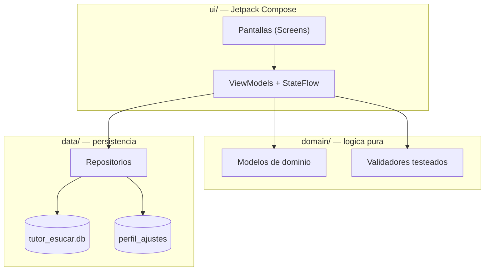

<div align="center">

# 🎓 Tutor Virtual ESUCAR

### Asistente movil para Trabajo de Titulo — Escuela de Suboficiales de Carabineros de Chile

**Kotlin · Jetpack Compose · Material 3 · Arquitectura MVVM**

<br>


-2.8.5-003B57?logo=sqlite&logoColor=white)


</div>

---

## 🧩 El problema que resuelve

Los estudiantes de **Trabajo de Titulo I, II y III** carecen de una herramienta movil que les
permita consultar la guia metodologica, resolver dudas de formato y citacion, y llevar el
control de sus entregas fuera del aula. Esta app funciona como **tutor virtual** que guia paso
a paso el proceso y reduce las consultas repetitivas a los profesores guia.

## ✨ Funcionalidades

| | Funcionalidad | Implementacion |
|---|---|---|
| 🔐 | **Acceso institucional** | Login y registro validados con perfiles (estudiante / profesor guia), correos solo `@esucar.cl`, contrasena segura (letra + numero + caracter especial), cifrada SHA-256 + salt, y sesion persistida |
| 🎨 | **Diseno Material 3** | Tema claro/oscuro con paleta institucional, NavigationBar, Cards, TopAppBar |
| 🧭 | **Navegacion funcional** | Navigation Compose con transiciones animadas entre pantallas |
| 📝 | **Formularios validados** | Formulario de entregable y de perfil, con mensajes de error por campo, datos institucionales con opciones predefinidas y seleccion multiple de items concretos |
| ✅ | **Validaciones desacopladas** | Logica centralizada en `domain/validation` (Validadores, ValidadorEntregable, ValidadorPerfil), probada con JUnit |
| 🏗️ | **Gestion de estado** | MVVM: ViewModels + StateFlow + repositorios |
| 💾 | **Almacenamiento local** | Room (entregables y usuarios) + DataStore (perfil y ajustes) — funciona sin conexion |
| 📷 | **Camara nativa** | Foto de perfil con `ActivityResultContracts.TakePicture` + `FileProvider` |
| 🔔 | **Notificaciones locales** | Recordatorios programados con `AlarmManager` un dia antes de la fecha limite (permiso `POST_NOTIFICATIONS` en tiempo de ejecucion) |
| 🎞️ | **Animaciones** | Transiciones entre pantallas, AnimatedVisibility, barra de progreso animada, colores por estado, escala al presionar tarjetas, contenido expandible en FAQ |

## 🛠️ Stack tecnologico

| Capa | Tecnologia | Version | Para que sirve |
|---|---|---|---|
| **Lenguaje** | Kotlin | 2.2.10 | Lenguaje principal de la app |
| **UI** | Jetpack Compose | BOM 2026.02.01 | UI declarativa 100% nativa |
| **UI** | Material 3 | via BOM | Sistema de diseno, tema dinamico claro/oscuro |
| **Navegacion** | Navigation Compose | 2.9.8 | Grafos de navegacion y argumentos tipados |
| **Arquitectura** | ViewModel + StateFlow | 2.9.4 | Gestion reactiva del estado (MVVM) |
| **Persistencia** | Room (SQLite) | 2.8.5 | Base de datos relacional local (entregables, usuarios) |
| **Persistencia** | DataStore Preferences | 1.3.0 | Perfil, ajustes y sesion persistida |
| **Build** | AGP + Gradle + KSP | 9.4.1 / 9.6.0 / 2.0.2 | Compilacion, wrapper y procesamiento de Room |
| **Testing** | JUnit 4 | 4.13.2 | 38 pruebas unitarias de validacion y autenticacion |

## 🏛️ Arquitectura (MVVM)



La UI **nunca** contiene reglas de negocio: solo muestra los mensajes que producen los
validadores del dominio, y accede a datos a traves de repositorios.

## 📁 Estructura del proyecto

```
app/src/main/java/cl/esucar/tutor/
├── TutorApp.kt                  Application + ServiceLocator
├── MainActivity.kt              Actividad unica (tema + navegacion)
├── domain/
│   ├── model/                   Modelos de dominio (Entregable, Etapa, Faq, Perfil)
│   └── validation/              Validaciones centralizadas (sin dependencias de UI)
├── data/
│   ├── local/                   Room: entidad, DAO y base de datos
│   ├── datastore/               DataStore: perfil y preferencias
│   └── repository/              Repositorios (Entregable, Guia, FAQ, Usuario)
├── notifications/               Notificaciones locales (canal, scheduler, receiver)
├── navigation/                  Rutas y NavHost con transiciones
└── ui/
    ├── theme/                   Tema Material 3
    ├── components/              Componentes reutilizables (campos validados, chips, progreso)
    ├── home/                    Inicio con progreso y accesos rapidos
    ├── guia/                    Guia metodologica y detalle de etapas
    ├── faq/                     Buscador de preguntas frecuentes
    ├── entregables/             Lista y formulario validado de entregables
    ├── perfil/                  Perfil, camara y ajustes
    └── auth/                    Login y registro institucional
```

## 🚀 Como ejecutar

1. Abrir el proyecto en **Android Studio** (File > Open > carpeta del repositorio).
2. Esperar la sincronizacion de Gradle (descarga automatica de dependencias).
3. Seleccionar un emulador (**API 24 o superior**) o dispositivo fisico con depuracion USB.
4. Ejecutar el boton **Run** (Shift + F10).

> **Requisitos:** Android Studio con JDK 17+, Android SDK 37, Gradle 9.6 (wrapper incluido).

### 🔑 Acceso de prueba

La app es institucional (ESUCAR): primero se debe iniciar sesion o registrarse con el perfil
correspondiente. Para pruebas existe la cuenta de demostracion:

| Campo | Valor |
|---|---|
| Correo | `demo@esucar.cl` |
| Contrasena | `demo1234` |

(Boton *"Ingresar con cuenta de demostracion"* en la pantalla de login). La sesion persiste en
el dispositivo y se cierra desde **Perfil > Cerrar sesion**.

## 💾 Persistencia local

- **Room** (`tutor_esucar.db`):
  - `entregables` — titulo, etapa, descripcion, fecha limite, estado *(Por iniciar / En desarrollo / Enviado / Aprobado)* y recordatorio.
  - `usuarios` — nombre, correo unico, hash de contrasena (SHA-256 + salt) y rol.
- **DataStore** (`perfil_ajustes`): nombre, correo, carrera, semestre, ruta de la foto, modo oscuro y preferencia de notificaciones.

## 🧪 Pruebas

`./gradlew test` — **38 pruebas JUnit, todas en verde** ✅

| Suite | Cobertura |
|---|---|
| `ValidadoresTest` (25) | Campos requeridos, email institucional, contrasena segura, nombre completo, semestre, fechas y formularios completos |
| `AuthValidacionTest` (12) | Login y registro: correos invalidos, contrasenas inseguras, confirmacion, perfiles |

## 👥 Equipo

<div align="center">

**Rodrigo Godoy** · **Axel Brogi**

*Asignatura:* DSY1105 — Desarrollo de Aplicaciones Moviles_002V (Duoc UC)
*Profesor:* Juan Guillermo Azocar Malverde

</div>
